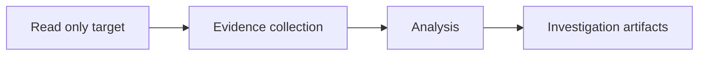

# Reverse Engineering Plan Template

> Save as `<project-folder>/plan/plan.md` for the **baseline buildout** (unnumbered), or
> `<project-folder>/plan/plan-<iteration-id>.md` for a later **Iteration**. This plan organizes
> investigation and documentation, not product implementation.

> **Iteration applicability.** Baselines use the complete required template. Later Iterations include changed investigation/design content and the current work breakdown, verification mapping, dependencies, and execution controls. Reference unchanged approved strategies and evidence contracts after verifying applicability; do not copy them or add N/A filler. Metadata, target/read-write boundaries, safety, sampling minimums, acceptance coverage, and pattern selection remain enforced.

## Metadata

- **Iteration ID:** [`baseline` for the baseline buildout, or the iteration's `Iteration-<YYYYMMDDTHHMMSSZ>-<token>`]
- **Plan confirmed date:** [YYYY-MM-DD]
- **Execution mode:** [Interactive | Autopilot with scope]
- **Execution pattern:** [Sequential | Parallel with cap]

## 1. Investigation architecture

### 1.1 Workstreams and boundaries

| ID | Workstream | Responsibility | Target read footprint | Artifact write footprint |
|----|------------|----------------|-----------------------|--------------------------|
| WS-1 | [name] | [responsibility] | [paths/systems/history] | [paths under artifact root] |

### 1.2 Evidence map

| Question | Primary evidence | Corroborating evidence | Validation | Expected limit |
|----------|------------------|------------------------|------------|----------------|
| Q-1 | E-1 | E-2 | [command/review] | [limit] |

### 1.3 Claim and contradiction strategy

[How claims are classified, citations are normalized, contradictions are
preserved, and stale/duplicate/generated sources are handled.]

### 1.4 Tool and access strategy

| Tool or integration | Purpose | Access boundary | Writes | Approval needed |
|---------------------|---------|-----------------|--------|-----------------|
| [tool] | [purpose] | [paths/network/data] | [none/artifact-only] | [condition] |

### 1.5 Sampling strategy

| Population | Selection rule | Minimum | Rationale | Bias/limitation |
|------------|----------------|---------|-----------|-----------------|
| [history/tests/features/commands] | [rule] | [number/percent/exhaustive] | [why] | [limit] |

### 1.6 Target protection and recovery

- **Pre-investigation snapshot:** [git status/hash/file manifest]
- **Write containment:** [mechanism]
- **Isolated command execution:** [throwaway copy/clone/container]
- **Post-investigation comparison:** [mechanism and zero-change threshold]
- **Abort conditions:** [target mutation, sensitive data, prohibited access]

## 2. Assessment documentation design

### 2.1 Document set

Use the [assessment templates](assessment/README.md). Map each document and
required section to `O-<n>` and `Q-<n>`. `agentic.md` may be omitted when the
target is not agentic; record the rationale in `assessment/README.md`.

| Document | Purpose | Required sections | Traces to |
|----------|---------|-------------------|-----------|
| `assessment/README.md` | Entry point and executive summary | [sections] | [Q/O IDs] |
| `assessment/product.md` | Product purpose and behavior | [sections] | [Q/O IDs] |
| `assessment/spec-and-use-cases.md` | Derived requirements and use cases | [sections] | [Q/O IDs] |
| `assessment/user-guide.md` | End-user guide (or link) | [sections] | [Q/O IDs] |
| `assessment/architecture.md` | System structure and boundaries | [sections] | [Q/O IDs] |
| `assessment/design.md` | Detailed behavior and design concepts | [sections] | [Q/O IDs] |
| `assessment/engineering.md` | Codebase and contribution workflow | [sections] | [Q/O IDs] |
| `assessment/build-and-run.md` | Install, setup, and build-and-run | [sections] | [Q/O IDs] |
| `assessment/operations.md` | Delivery, security, and support | [sections] | [Q/O IDs] |
| `assessment/agentic.md` | Agentic/AI behavior, when applicable | [sections or N/A] | [Q/O IDs] |
| `assessment/findings.md` | Gaps, risks, unknowns, and corrections | [sections] | [Q/O IDs] |
| `assessment/backlog.md` | Pending backlog + next-release candidates | [sections] | [Q/O IDs] |
| `assessment/evidence.md` | Sources, validation, and limitations | [sections] | [Q/O IDs] |

### 2.2 Architecture and design views

| View | Diagram or table | Evidence inputs | Validation |
|------|------------------|-----------------|------------|
| System context | Styled Mermaid flowchart | [sources] | [review/check] |
| Components | Styled Mermaid flowchart and table | [sources] | [review/check] |
| Runtime/data flow | Sequence or flow diagram | [sources] | [review/check] |

### 2.3 Inventories

| Inventory | Required fields | State taxonomy | Coverage target |
|-----------|-----------------|----------------|-----------------|
| Features | actor, trigger, surfaces, data, tests, docs, evidence | active/optional/partial/experimental/retired/historical/unknown | [target] |
| Dependencies | name, version source, scope, purpose, risk | current/unknown/deprecated | [target] |

### 2.4 Documentation structure

[Reading paths by audience, glossary location, cross-linking, and the criteria
for splitting a document. `assessment/README.md` remains the canonical entry
point.]

### 2.5 Verification design

| Check | Input | Output | Pass condition | ACs |
|-------|-------|--------|----------------|-----|
| Claim coverage | Assessment documents + sources | `assessment/evidence.md` | [threshold] | AC-1 |
| Target integrity | Pre/post snapshots | `assessment/evidence.md` | Zero unauthorized changes | [AC] |

## 3. Orchestration

### 3.1 Work breakdown

Assign each work item to one or more EXECUTE analysis tasks (`3b`-`3f`). Each
assignment produces an `execute/<task>/<work-item>` replay entry. Delete unused
example rows.

| ID | Workstream | Title | Description | EXECUTE tasks | Target read footprint | Artifact write footprint | Traces to |
|----|------------|-------|-------------|---------------|-----------------------|--------------------------|-----------|
| W-1 | WS-1 | [title] | [description] | [3b..3f] | [read paths] | [artifact paths] | [Q/O/AC IDs] |
| W-2 | WS-1 | [title] | [description] | [3b..3f] | [read paths] | [artifact paths] | [Q/O/AC IDs] |

### 3.2 Sequencing and dependencies

- **W-2 depends on:** W-1

### 3.3 Acceptance and output coverage

| Question/output/AC | Work items | Verification task |
|--------------------|------------|-------------------|
| Q-1 | W-1 | 3h |

### 3.4 Execution controls

- **Pattern and concurrency:** [selection, cap, rationale]
- **Command policy:** [allowed/prohibited/approval-gated]
- **Network policy:** [allowed/prohibited/approval-gated]
- **Sensitive-data controls:** [scan/redact/escalate]
- **Time/cost budget:** [limits]
- **Stop/escalate conditions:** [conditions]

---

## PLAN-EXIT validation checklist

1. Metadata Iteration ID matches the corresponding spec and, when newly minted, matches the `Iteration-<YYYYMMDDTHHMMSSZ>-<token>` rule in core §4.3 (pre-existing legacy IDs remain valid).
2. Baseline sections 1-3 and every H3 subsection are present and non-empty. Iterations retain current work/verification/dependency/control content and include only affected architecture/design sections; unchanged applicable content may be referenced in approved plans.
3. Each workstream has a unique `WS-<n>` ID and read/write footprints.
4. Every write footprint is under the approved artifact root.
5. Every current or inherited approved `Q-<n>`, `O-<n>`, and `AC-<n>` affected by
   the intent is covered by current work and verification. Baselines cover all;
   unchanged applicable coverage may reference approved artifacts rather than
   inventing repeated investigation work.
6. Sampling meets or exceeds the spec minimums.
7. Target pre/post comparison and isolated command strategy are explicit.
8. The assessment document set covers every required output.
9. Required architecture/design views and inventories have evidence and
   validation mappings.
10. Every work item has a unique `W-<n>` ID, footprints, at least one assigned
    EXECUTE task (`3b`-`3f`), and valid traces.
11. Dependencies reference existing work items and form an acyclic graph.
12. Command, network, sensitive-data, time/cost, and escalation controls are
    explicit.
13. Sequential/Parallel selection is recorded in a `meta/execution-pattern`
    replay entry whose `Execution outcome` is `pattern: sequential` or
    `pattern: parallel, cap=<n>`.
14. No template placeholder and no unused example row remains.
