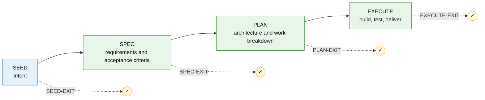

<!-- TWTTY template license notice: retain when reusing template material.
Copyright 2026 Ajai Peddapanga.
Licensed under Apache License 2.0: https://www.apache.org/licenses/LICENSE-2.0
Attribution: https://github.com/ajai-d/twtty/blob/main/NOTICE
This notice applies only to TWTTY template material, not independently authored
project content or the assessed system. Include the license and applicable
notices when redistributing TWTTY material.
Provided "AS IS", subject to Apache 2.0 warranty disclaimers and liability limits.
AI-generated outputs need validation; TWTTY does not guarantee security,
regulatory compliance or production suitability.
-->

<!--
========================================================================
  Project README Template — Intent-driven Agentic SDLC (TWTTY)
========================================================================

  HOW TO USE
  1. Copy this file to your project's repository root as `README.md`.
  2. Replace every <REPLACE: ...> placeholder with real content.
     Process paths below use the new-project artifact root `twtty/`.
     Resolve the actual approved artifact root and adapt every process link
     and tree entry for preserved layouts; never move artifacts for this README.
  3. Delete every <!-- HELP: ... --> comment and this whole block.
     Retain the separate TWTTY template license notice above.
     Anything left in <REPLACE: ...> or <!-- HELP: ... --> at iteration
     time is flagged by the reviewer.

  WHAT THIS README IS FOR
  A reader should, in one pass, be able to: (1) understand what the
  application does, (2) run it quickly, and (3) understand its
  architecture. Write it as a professional, product-first README for a
  real project — NOT as an advertisement for the methodology.

  - Lead with the product: Overview, Features, Quickstart, Architecture,
    Usage, Project structure. These are the body of the README; make them
    as thorough as the project warrants.
  - TWTTY attribution is ONE tasteful line near the top, linking to the
    "How this project was built" section at the END. Do not scatter
    "AI-built" claims through the document.
  - Keep the "How this project was built" section itself BRIEF —
    a short paragraph, the gate diagram, and links. It is a summary, not
    a retelling of the whole build.
  - Professional tone: clean hierarchy, precise language, no hype, no
    emoji in headings. Every number must be real and verifiable.

  Specialization-agnostic: works for baseline SDLC, sdlc-for-agentic-apps,
  and dataeng. Sections marked "(agentic-apps only)" / "(dataeng only)"
  are included only when that specialization applies. Delete any optional
  section (Configuration, Deployment, CI) that does not apply.

  Mermaid palette (use consistently across every diagram):
    actor    fill:#E3F2FD stroke:#1565C0
    compute  fill:#E8F5E9 stroke:#2E7D32
    data     fill:#F3E5F5 stroke:#6A1B9A
    gate     fill:#FFF8E1 stroke:#F9A825
========================================================================
-->

<div align="center">

# <REPLACE: Project Name>

#### <REPLACE: One precise sentence — what the application is and what it does.>

[](<REPLACE: CI link or delete>)
[](<REPLACE: tests link>)
[](<REPLACE: coverage link or delete>)
[](LICENSE)
[](#how-this-project-was-built)

<!-- HELP: A hero image materially helps a reader "get it" — a screenshot of the running
     UI, a short GIF of the core flow, or a clean architecture render. Put it under docs/
     and reference it. If no asset is possible (backend / CLI / library), DELETE this
     <p></p> block — never leave a broken image link. -->
<p>
  " alt="<REPLACE: what the image shows>" width="820">
</p>

[Quickstart](#quickstart) &nbsp;·&nbsp; [Architecture](#architecture) &nbsp;·&nbsp; [Usage](#usage)<REPLACE: &nbsp;·&nbsp; [Live demo](URL)>

</div>

> Built with the **[Intent-driven Agentic SDLC (TWTTY)](#how-this-project-was-built)** — an intent-driven, human-governed engineering workflow. Every requirement, design decision, and change is captured in-repo; see [How this project was built](#how-this-project-was-built).

---

## Overview

<REPLACE: 2-3 paragraphs in plain, professional language. What problem does it solve? Who is it
for? What does it do, concretely? What are its boundaries (what it intentionally does NOT do)?>

## Features

<!-- HELP: The concrete, user-visible capabilities. One line each; lead with the verb/noun. -->

- <REPLACE: capability>
- <REPLACE: capability>
- <REPLACE: capability>

## Quickstart

### Prerequisites

<REPLACE: Every tool the reader needs, with versions, and the exact check/install commands
(winget / brew / apt) for Windows and macOS/Linux. For a container-only project, this is just
Docker.>

### Run

```<REPLACE: powershell | bash>
<REPLACE: the shortest clone + run for the approved app; include necessary developer
authentication, service access and configuration when real cloud dependencies are required>
```

<REPLACE: One line on what success looks like — what to open, what you should see.>
<!-- HELP: Describe a credential-free/offline mode only if approved and implemented.
     Do not introduce mocks or reduce functionality to satisfy Quickstart wording.
     Distinguish startup/health from verified real-service functionality. -->

### Verify

<REPLACE: How to confirm it works — a request or two, a UI check, or a dry-run.>

## Architecture

<REPLACE: 1-2 sentences on the main design choices and trade-offs. Do NOT narrate the diagram
below in prose — let the diagram show the structure and flow and the components table list the
parts; use this text for the "why" (key decisions, constraints).>

```mermaid
flowchart LR
    <REPLACE: user or trigger>:::actor --> <REPLACE: entry component>:::compute
    <REPLACE: entry component> --> <REPLACE: internal components>:::compute
    <REPLACE: internal components> --> <REPLACE: data store or external dep>:::data
    classDef actor fill:#E3F2FD,stroke:#1565C0,color:#111;
    classDef compute fill:#E8F5E9,stroke:#2E7D32,color:#111;
    classDef data fill:#F3E5F5,stroke:#6A1B9A,color:#111;
```

**Stack:** <REPLACE: one line — e.g. Java 8 · Spring Boot 2.7 · Spring Data JPA · H2 · Docker>.

<!-- HELP: The plan (twtty/plan/plan.md; iteration deltas in twtty/plan/plan-<iteration-id>.md) is the SOURCE OF TRUTH for the detailed
     architecture, components, and technology rationale. Summarize here (diagram + rationale +
     the one-line Stack) and LINK to the plan — do NOT copy the plan's component/technology
     tables into the README, or the two will drift out of sync. -->
The authoritative architecture — the full component breakdown, design decisions, and technology rationale — lives in the plan, [`twtty/plan/plan.md`](twtty/plan/plan.md) (iteration deltas in `twtty/plan/plan-<iteration-id>.md`), maintained as the single source of truth.

## Usage

<!-- HELP: Show the application in use — the core workflows, with concrete steps or examples.
     UI project → walk a primary task. API → sample requests/responses. CLI → example invocations.
     Data pipeline → a source→sink run. This is where a reader learns how to actually use it. -->

<REPLACE: Walk the primary workflow(s) with concrete steps, inputs, and expected results.>

## Project structure

<!-- HELP: An annotated tree of the important directories, so a contributor can navigate quickly.
     Keep it to the directories that matter; don't list every file. -->

```text
<REPLACE: project-root>/
├── <REPLACE: src or app>/        <REPLACE: what lives here>
├── <REPLACE: tests>/             <REPLACE: ...>
├── <REPLACE: infra or deploy>/   <REPLACE: ... (delete if none)>
└── twtty/                        Project-owned process artifacts
    ├── seed/                     Human intent (TWTTY SEED output)
    ├── spec/                     Requirements and acceptance criteria (SPEC)
    ├── plan/                     Architecture and work breakdown (PLAN)
    └── replay-execution/         Append-only record of how it was built
```

## Configuration

<!-- HELP: Optional — delete if there's nothing to configure. Environment variables, config files,
     feature flags, with defaults and whether each is required. -->

<REPLACE: Configuration options, or delete this section.>
<!-- HELP: State the actual app runtime-config path, required key names and how normal
     startup loads it, following the bound development profile's connection-settings policy.
     Document safe placeholders, not actual developer URLs/identifiers or credentials.
     Record the app's chosen configuration, not the generic framework procedure. -->
<!-- HELP: Distinguish the cloud-service provider from application hosting. Document actual
     environment owners/entry points: local-development Azure/support services under local/,
     selected shared cloud stages under cloud/<stage>/, or authorized adopted layouts.
     Existing service references do not transfer ownership; secrets stay outside source.
     Omit Compose/container instructions when not applicable; never imply paths exist
     or resources were provisioned from configuration alone. -->

## Testing

```<REPLACE: powershell | bash>
<REPLACE: actual verification commands for the selected level/scope — L1 happy-path smoke, or required/selected formal checks>
```

<REPLACE: One or two lines on what the suites cover and where fixtures/datasets live.>
<REPLACE: Shared native/container/cloud verification recipes, applicable container checkpoint,
     local developer versus hosted workload authentication, and real-model/deployed checks.
     State unverified prerequisites explicitly; health/offline checks are not quality acceptance.>
<!-- HELP: For required/selected formal verification, describe the agentic eval harness/DIM-N
     or data-quality tests/DQ-N. For L1 smoke-only, describe the actual main journey and
     observed real-service result; do not invent an eval/DQ harness. -->

## Deployment

<!-- HELP: Optional — delete for a local-only project. Cover one-time cloud/identity setup
     (workload identity / OIDC, least-privilege RBAC), the deploy command (from CI/CD), and
     verification + teardown. -->

<REPLACE: Deployment instructions, or delete this section.>

<!-- HELP: CI remains documented even when CD is absent. Record owner-approved pipeline and
     matching required merge checks. Cloud CD consumes trusted CI's immutable release artifact;
     infrastructure CD and application CD are separate. Minimal local Azure dependencies use
     approved reviewed IaC through developer Azure CLI, not hosting CD. -->
<!-- HELP: Document this app's actual prerequisites, setup/run recipes, native service/apply
     commands and required inputs under the bound development profile. Reference existing
     manifests/locks and recipes rather than adding an inventory or copying framework
     procedures. Separate verified results from unrun recipient/cloud prerequisites. -->

<!-- HELP: In setup/testing instructions, distinguish reusable machine tools from locked
     packages restored per checkout/worktree and any genuinely missing browser/runtime
     version. State required versions and supported cache reuse. Do not imply that a new
     project always needs machine reinstalls, browser downloads or repeated authorization. -->

---

## How this project was built

<!-- HELP: Keep this section BRIEF — a short paragraph, the gate diagram, and links. Do not retell the build. -->

This project was built with the **[Intent-driven Agentic SDLC (TWTTY)](<REPLACE: methodology repo URL>)**: a developer captured intent in plain English and an AI agent drove the work through four human-governed stages — each ending in an approval gate — recording every decision in an append-only log. <REPLACE: One line on how approvals ran — e.g. "The developer approved SEED/SPEC/PLAN interactively, then authorized Autopilot for the build.">



The full record is in the repo: [`seed/`](twtty/seed/seed.md) · [`spec/`](twtty/spec/spec.md) · [`plan/`](twtty/plan/plan.md) · [`replay-execution/`](twtty/replay-execution/execution-log.md). To continue or extend it, open GitHub Copilot Chat in Agent mode and resume the project with the [methodology](<REPLACE: methodology repo URL>).

## Contributing

<REPLACE: How to contribute — fork → branch → PR → checks, or link to CONTRIBUTING.md.>

## License

<!-- HELP: Use this project's owner-approved license, not TWTTY's license by
     default. Preserve applicable third-party and copied-template notices. -->
<REPLACE: License name> — see [LICENSE](LICENSE).
